# GST Sentinel: Enterprise AI GST Risk Intelligence & ITC Assurance Platform

[](https://fastapi.tiangolo.com/)
[](https://streamlit.io/)
[](https://www.mongodb.com/)
[](https://neo4j.com/)
[](https://scikit-learn.org/)

An enterprise-grade, unsupervised machine learning and knowledge graph platform designed to identify leakage, automate tax compliance, audit tax invoice anomalies, and mitigate Input Tax Credit (ITC) reversal exposure for corporate CFOs.

---

## 1. Executive Summary

In the Indian Goods and Services Tax (GST) framework, corporate buyers can only claim **Input Tax Credit (ITC)**—the tax offset on business purchases—if their suppliers actually file outward supply returns (GSTR-1), pay their taxes (GSTR-3B), and report matching invoice details to the government portal. 

When a vendor defaults, late-files, or mismatch-reports, tax authorities block or reverse the buyer's ITC, forcing the buyer to pay the tax a second time along with an **18% annual interest penalty**. For large enterprises working with thousands of suppliers, vendor-driven tax defaults represent millions of rupees in direct capital leakage, high operational overhead, and audit exposure.

**GST Sentinel** solves this systemic risk. By ingesting, parsing, and reconciling transactional data across all GST compliance layers—Invoices, GSTR-1, GSTR-2B (auto-drafted ITC), GSTR-3B (tax payments), E-Way Bills (transport documents), and Purchase Registers—the platform acts as a continuous audit system. Leveraging an **unsupervised Isolation Forest pipeline**, a **Neo4j Knowledge Graph**, and an **Explainable AI (XAI) engine**, GST Sentinel automatically detects suspicious transactions, quantifies financial exposure, explains compliance failures, and reveals hidden collusive networks before payments are released.

---

## 2. Key Features

### 🛡️ Compliance Intelligence
Cross-collection compliance matching. It dynamically validates GSTR-1 filing dates and statuses against invoice dates to calculate exact filing lags, mismatch penalties, and filing rates.

### 🕸️ Knowledge Graph Analytics
A Neo4j-powered graph network mapping relations: `(Taxpayer)-[:ISSUED]->(Invoice)-[:BILLED_TO]->(Taxpayer)`. It runs Cypher-based path queries to detect circular trading loops (fraud rings inflating turnovers) and shadow networks sharing suspicious contact patterns.

### 🧠 Unsupervised Anomaly Detection
An Isolation Forest machine learning pipeline that scales to 28 engineered compliance features per invoice to identify statistical outliers without requiring historical fraud labels.

### 💡 Explainable AI (XAI)
Causal, actionable explanation engine. For every flagged invoice, it analyzes feature z-score divergence against the population baseline to output ranked, severity-coded reasons (e.g. late filing penalties, transport document mismatch, or abnormal z-score).

### 📋 Invoice Investigation Console
A split-screen control center. Investigators can review purchase register discrepancies alongside the exact compliance signals checklist and ML feature weights in one unified view.

### 📊 Executive CFO Dashboard
An enterprise dashboard designed for corporate decision-makers. It aggregates portfolio-level metrics, displays active warning alerts, projects blocked ITC, and calculates a weighted Portfolio Risk Index.

---

## 3. System Architecture

The system is split into an asynchronous FastAPI backend and a Streamlit frontend, communicating over local/secured HTTP routing.

```mermaid
graph TD
    %% Input Layer
    subgraph Data Input
        CSV["Raw CSV Files<br>(Invoices, GSTR1, GSTR2B, GSTR3B, EWayBill, Purchase Register, Taxpayers)"]
    end

    %% Storage Layer
    subgraph Storage & Ingestion
        Ingest["Ingestion Engine<br>(Content Hash Validation)"]
        Mongo[("MongoDB Atlas<br>(7 Collections + Log)")]
        Neo[("Neo4j Graph Database<br>(Taxpayer & Invoice Nodes)")]
    end

    %% Backend Layer
    subgraph FastAPI API Backend
        Auth["X-API-Key Gateway"]
        Sync["Graph Sync Engine"]
        
        subgraph ML Pipeline
            Feat["Feature Builder<br>(28 Columns)"]
            Impute["Median Imputer"]
            Scale["Standard Scaler"]
            IF["Isolation Forest"]
            XAI["XAI Explanation Engine"]
        end
        
        Router["FastAPI Router<br>(/ml, /dashboard, /graph)"]
    end

    %% Frontend Layer
    subgraph Streamlit UI Frontend
        Dash["CFO Dashboard"]
        MLDash["ML Risk Intelligence Console"]
        Explorer["Investigation Panel"]
    end

    %% Data Flows
    CSV -->|Read File Bytes| Ingest
    Ingest -->|Idempotent Upsert| Mongo
    Mongo -->|Batch Extract| Sync
    Sync -->|Cypher Merges| Neo
    Mongo -->|Motor Async Queries| Feat
    Feat -->|Numeric Matrix| Impute
    Impute --> Scale
    Scale --> IF
    IF -->|Isolation Score| XAI
    XAI -->|Ranked Explanations| Router
    Router -->|JSON Payloads| Dash
    Dash --> MLDash
    MLDash --> Explorer
```



### Database Graceful Degradation
* **Primary Store**: MongoDB acts as the single source of truth.
* **Secondary Graph Store**: Neo4j is optional. If Neo4j is offline, the backend catches connection timeouts gracefully and falls back to deriving vendor connections using MongoDB aggregates. This keeps the application fully functional, disabling only graph-native visualizations (loops and shadow networks).

---

## 4. Data Flow

```
[Raw CSV Files]
      │
      ▼
1. Ingestion Engine  ──► Calculates SHA-256 hash. If changed, drops previous records
      │                  for the file and upserts rows into MongoDB.
      ▼
2. MongoDB Atlas     ──► Persists Invoices, Taxpayers, GSTR1, GSTR2B, GSTR3B,
      │                  EWayBill, and Purchase Register.
      ├──────────────────┐
      ▼                  ▼
3. Neo4j Graph Sync    4. Feature Engineer (ml/features.py)
   Maps relationships     Calculates 28 features (e.g., filing rates, tax variances,
   and runs Cypher        z-scores, temporal clustering, buyer/seller risk categories).
   matching.             │
                         ▼
                       5. Machine Learning Pipeline (ml/model.py)
                          Imputes missing features using medians, scales values,
                          and fits the Isolation Forest model.
                         │
                         ▼
                       6. Explainable AI Engine (ml/explainer.py)
                          Computes population-level percentiles. Calculates feature
                          z-score divergence to output ranked, severity-coded explanations.
                         │
                         ▼
                       7. FastAPI Backend Routers (routes/ml.py)
                          Exposes serializable Pydantic response schemas.
                         │
                         ▼
                       8. Streamlit Dashboard (frontend/dashboard.py)
                          Renders executive progress gauges, KPI grids, top anomalies list,
                          and the split-pane investigation console.
```

---

## 5. Machine Learning Pipeline

### Problem Statement
In invoice audit analytics, fraud patterns are highly dynamic, and labeled historical fraud data is extremely sparse. Supervised classification would fail to capture zero-day fraud profiles or novel tax evasion strategies. Thus, we model invoice risk as an **unsupervised anomaly detection** problem.

### Algorithm Selection: Isolation Forest
We chose the **Isolation Forest (IF)** algorithm because:
1. **Differentiable Isolation**: Instead of profiling "normal" points (like One-Class SVM or clustering), it isolates anomalies by randomly selecting a feature and a split value. Anomalies have shorter path lengths in the isolation trees due to their extreme values.
2. **Feature Scale Robustness**: It performs well in high-dimensional feature spaces (28 dimensions) and handles non-linear interactions without strong parametric assumptions.
3. **Efficiency**: It has a linear time complexity $O(n)$, making it suitable for processing millions of corporate invoices.

### Feature Engineering Taxonomy
The pipeline transforms 7 raw database collections into a 28-feature matrix:

| Category | Feature Name | Description | Regulatory Relevance |
| :--- | :--- | :--- | :--- |
| **A: Value** | `invoice_value` | Raw declared invoice amount. | Identifies outlier transaction values. |
| | `log_invoice_value` | Log-transformed invoice value. | Normalizes the heavy-tailed invoice distribution. |
| | `effective_tax_rate` | Tax divided by invoice value. | Detects rate misclassification (normal is ~18%). |
| **B: Filing** | `gstr1_filed` | Binary indicator (1 = filed, 0 = missing). | Determines if the customer is eligible to claim ITC. |
| | `gstr1_status_encoded` | Ordinal: Filed=0, Late=1, Pending=2, Missing=3. | Measures severity of filing compliance delays. |
| | `days_to_file` | Lag (days) between invoice and GSTR-1 filing. | Long lags indicate backdated invoice stuffing. |
| **C: ITC** | `itc_eligible` | Binary indicator (1 = eligible, 0 = blocked). | Flags transactions blocked by tax authorities. |
| | `gstr2b_value_discrepancy`| Normalized variance between GSTR-2B and Invoice. | Identifies declaration mismatches. |
| | `pr_value_discrepancy` | Normalized variance between Purchase Register and Invoice. | Flags over-claiming of tax credits by the buyer. |
| | `pr_tax_discrepancy` | Normalized variance between Purchase Register and GSTR-1. | Flags tax amount discrepancies. |
| **D: Transport**| `has_ewaybill` | Binary indicator (1 = present, 0 = missing). | E-Way Bill is legally mandatory for goods >₹50,000. |
| | `ewb_value_discrepancy` | Normalized variance between E-Way Bill and Invoice. | Detects circular trading without physical movement. |
| **E: Seller** | `seller_invoice_count` | Total invoice count issued by the seller. | Establishes the seller's commercial baseline. |
| | `seller_avg_value` | Seller mean invoice value. | Identifies deviations from historical averages. |
| | `seller_value_std` | Standard deviation of seller invoice values. | Very low variance flags automated invoice generators. |
| | `invoice_value_zscore` | Invoice value standard deviations from seller mean. | Flags statistical anomalies. |
| | `seller_filing_rate` | GSTR-1 filed count divided by total invoices. | Measures chronic supplier filing rates. |
| | `seller_late_rate` | Late GSTR-1 count divided by filed invoices. | Measures chronic supplier filing delays. |
| | `seller_gstr3b_payment_rate`| Paid GSTR-3B count divided by total filings. | Flags tax collection without government remittance. |
| | `seller_itc_block_rate` | Blocked invoices divided by total seller invoices. | Measures how often the supplier is flagged. |
| | `seller_risk_encoded` | Ordinal risk: High=2, Medium=1, Low=0. | Integrates government taxpayer classification. |
| **F: Buyer** | `buyer_invoice_count` | Total invoice count received by the buyer. | Establishes the buyer's baseline. |
| | `buyer_avg_value` | Buyer mean invoice value. | Establishes the buyer's average. |
| | `buyer_itc_block_rate` | Blocked invoices divided by total buyer invoices. | Measures buyer exposure to bad suppliers. |
| | `buyer_risk_encoded` | Ordinal risk: High=2, Medium=1, Low=0. | Integrates government buyer classification. |
| **G: Temporal**| `invoice_day` | Day of the month (1–31). | Detects invoice backdating at month-ends. |
| | `invoice_month` | Month of the year (1–12). | Captures seasonal tax declaration spikes. |

### Normalization and Scoring
1. **Raw Isolation Scores**: The raw score from `IsolationForest.decision_function()` returns positive values for normal instances and negative values for anomalous ones.
2. **Min-Max Scaling**: We invert and normalize the raw score to a $[0, 1]$ risk score:
   $$\text{risk\_score} = \frac{-\text{raw\_score} - \text{min}}{\text{max} - \text{min}}$$
   A higher `risk_score` indicates a more anomalous transaction.
3. **Risk Categorization**:
   - **CRITICAL**: $\text{risk\_score} \ge 0.75$ (Immediate payment hold)
   - **HIGH**: $\text{risk\_score} \ge 0.50$ (Filing matching required)
   - **MEDIUM**: $\text{risk\_score} \ge 0.30$ (Compliance warnings)
   - **LOW**: $\text{risk\_score} < 0.30$ (Pass/Normal)

---

## 6. Explainable AI (XAI)

Unsupervised models are often criticized as "black boxes." In corporate finance, a CFO cannot hold a supplier's payment based on a raw anomaly score without evidence. 

Our **Explainable AI engine** resolves this by translating statistical deviations into clear compliance reasons. For every invoice, the engine calculates the z-score divergence of each feature against the population distribution (mean, standard deviation, percentiles). It then ranks and formats these deviations into actionable warnings:

```
[Anomaly Score: 0.8242 (CRITICAL)]
       │
       ├─► 1. 🚨 CRITICAL AUDIT WARNING: 
       │      Invoice value ₹1,200,000 is critically higher than seller's average of 
       │      ₹124,500 (z-score: +4.32, ratio: 9.6x) — potential invoice stuffing.
       │
       ├─► 2. 🚨 CRITICAL AUDIT WARNING: 
       │      E-Way Bill is missing for invoice of ₹1,200,000 — legally mandatory 
       │      for goods movement above ₹50,000. Potential fictitious transaction.
       │
       └─► 3. ⚠️ COMPLIANCE WARNING: 
              Seller has only 58% GSTR3B payment confirmation rate — supplier collects 
              GST from buyers but fails to remit it to the government.
```

---

## 7. Technical Stack

| Layer | Technology | Version | Purpose |
| :--- | :--- | :--- | :--- |
| **Frontend** | Streamlit | `>= 1.40.0` | Executive and investigation user interface. |
| | Pandas | `>= 2.0.0` | Client-side data manipulation and table rendering. |
| | Requests | `>= 2.31.0` | HTTP communication with the FastAPI gateway. |
| **Backend** | FastAPI | `>= 0.115.0` | High-performance asynchronous REST API gateway. |
| | Uvicorn | `>= 0.30.0` | ASGI server execution. |
| | Pydantic | `>= 2.5.0` | Strict data serialization and API request validation. |
| | Pydantic Settings | `>= 2.2.0` | System environment variable validation. |
| **Database** | MongoDB Atlas | `6.0` (or local) | Primary document store for raw compliance collections. |
| | Motor | `>= 3.3.0` | Asynchronous MongoDB driver for asyncio event loop compatibility. |
| | Neo4j | `>= 5.15.0` | Graph database for network analytics (loops and shadow networks). |
| **Machine Learning** | Scikit-Learn | `>= 1.4.0` | Median Imputer, Standard Scaler, and Isolation Forest. |
| | Joblib | `>= 1.3.0` | Model serialization and disk persistence. |
| | Numpy | `>= 1.26.0` | High-performance vector operations and statistical metrics. |

---

## 8. Directory Structure

```
gst_ml/
├── .env.example              # Environment variables template
├── .gitignore
├── Dockerfile                # Multi-service entrypoint container config
├── docker-compose.yml        # Multi-container service orchestrator
├── requirements.txt          # Python project dependencies
├── run_ingest.py             # Script to trigger batch ingestion locally
├── check_db.py               # Database verification script
├── test_backend.py           # Backend check utility
├── test_backend_8001.py
├── backend/                  # API Backend Service
│   ├── __init__.py
│   ├── auth.py               # X-API-Key middleware gateway
│   ├── config.py             # Pydantic environment validation settings
│   ├── database.py           # MongoDB and Neo4j driver connection singletons
│   ├── indexes.py            # MongoDB background index setup
│   ├── ingestion.py          # CSV/JSON parser with content hashing
│   ├── graph_sync.py         # Incremental sync from MongoDB to Neo4j
│   ├── main.py               # FastAPI server launcher and configuration
│   ├── models.py             # Core request/response schemas
│   ├── ml/                   # Machine Learning Pipeline
│   │   ├── __init__.py
│   │   ├── explainer.py      # Feature z-score divergence explanation engine
│   │   ├── features.py       # 28-feature engineering pipeline
│   │   ├── model.py          # Isolation Forest training and persistence
│   │   └── schemas.py        # ML API-specific Pydantic schemas
│   └── routes/               # API Router Handlers
│       ├── __init__.py
│       ├── dashboard.py      # CFO dashboard read routers
│       ├── graph.py          # Neo4j circular trading and audit routers
│       ├── health.py         # System health monitor router
│       ├── ingest.py         # Data ingestion endpoint router
│       └── ml.py             # Machine learning scoring and retraining routers
└── frontend/                 # Streamlit UI Service
    ├── api_client.py         # HTTP communication helper client
    ├── cfo_dashboard.py      # Core Streamlit navigation router
    ├── dashboard.py          # Streamlit launcher script
    └── ml_risk_page.py       # Rebuilt, premium ML Risk Intelligence console
```

---

## 9. Installation Guide

### Prerequisites
* Python `3.11` or `3.12` installed.
* Local MongoDB instance (or MongoDB Atlas account).
* Local Neo4j instance (or Neo4j Aura cloud account, optional).

### Step 1: Clone and Set Up Environment
```bash
git clone https://github.com/yourusername/gst_ml.git
cd gst_ml
python -m venv venv
source venv/bin/activate  # On Windows: venv\Scripts\activate
pip install -r requirements.txt
```

### Step 2: Configure Environment Variables
Copy the template to create a `.env` file:
```bash
copy .env.example .env  # On Linux/macOS: cp .env.example .env
```
Edit the `.env` file and set your credentials:
```ini
DEBUG=True
APP_NAME=GST Sentinel
PORT=8001
HOST=0.0.0.0

# MongoDB URI (Set Atlas cluster or local URL)
MONGO_URI=mongodb://localhost:27017
MONGO_DB_NAME=gst_reconciliation

# Neo4j URI (Optional, leave defaults if not running)
NEO4J_URI=bolt://localhost:7687
NEO4J_USER=neo4j
NEO4J_PASSWORD=password

# Security - Configures X-API-Key header verification
# API_KEY=your_secure_api_key_here

BACKEND_URL=http://localhost:8001
```

### Step 3: Run the Services Locally

1. **Start MongoDB**: Ensure MongoDB is running locally on port `27017`.
2. **Launch the FastAPI Backend**:
   ```bash
   python -m uvicorn backend.main:app --host 0.0.0.0 --port 8001
   ```
3. **Launch the Streamlit Frontend** (in a separate terminal):
   ```bash
   python -m streamlit run frontend/dashboard.py --server.port 8502
   ```

### Step 4: Populate Data
1. Open the dashboard in your browser: `http://localhost:8502`.
2. In the sidebar, select **Ingest Data**.
3. Click **Start Ingestion** to load the sample CSV files located in `backend/files/` into your MongoDB collections.
4. Click **Sync Graph** to load relationships into your Neo4j database.
5. In the sidebar, select **ML Risk Intel** and click **Train Model Now** to fit the Isolation Forest model on the newly ingested data.

---

## 10. API Documentation

All protected endpoints require the header `X-API-Key` when `API_KEY` is configured in the `.env` file.

### 1. GET `/ml/risk-summary`
Returns the portfolio-level risk distribution, estimated exposure, average risk index, and top suspicious transactions.

* **Example Request**:
  ```bash
  curl -X GET http://localhost:8001/ml/risk-summary -H "X-API-Key: your_key"
  ```
* **Example Response**:
  ```json
  {
    "total_invoices": 78,
    "model_trained": true,
    "model_trained_at": "2026-06-11T12:00:00Z",
    "contamination_rate": 0.15,
    "risk_distribution": {
      "LOW": 54,
      "MEDIUM": 12,
      "HIGH": 8,
      "CRITICAL": 4
    },
    "top_anomalies": [
      {
        "invoice_id": "INV-42",
        "seller_gstin": "27AAAAA1111A1Z1",
        "buyer_gstin": "27BBBBB2222B2Z2",
        "invoice_value": 1500000.0,
        "risk_score": 0.9421,
        "risk_level": "CRITICAL",
        "anomaly_reasons": [
          "Invoice value is critically higher than seller's average...",
          "E-Way Bill missing..."
        ],
        "isolation_score": -0.1824
      }
    ],
    "most_flagged_features": [
      {
        "feature": "GSTR1 Not Filed",
        "flag_count": 18,
        "description": "Seller did not file GSTR1 return"
      }
    ],
    "avg_risk_score": 0.2412,
    "total_invoice_value_at_risk": 4500000.0,
    "total_blocked_itc": 810000.0
  }
  ```

### 2. GET `/ml/anomaly/{invoice_id}`
Returns complete compliance checks and all 28 engineered features for a single invoice.

* **Example Request**:
  ```bash
  curl -X GET http://localhost:8001/ml/anomaly/INV-42 -H "X-API-Key: your_key"
  ```
* **Example Response**:
  ```json
  {
    "invoice_id": "INV-42",
    "seller_gstin": "27AAAAA1111A1Z1",
    "buyer_gstin": "27BBBBB2222B2Z2",
    "invoice_value": 1500000.0,
    "risk_score": 0.9421,
    "risk_level": "CRITICAL",
    "anomaly_reasons": ["E-Way Bill missing..."],
    "isolation_score": -0.1824,
    "seller_name": "Acme Supplier Ltd",
    "buyer_name": "Apex Industries Ltd",
    "invoice_date": "2026-06-01",
    "features": {
      "invoice_value": 1500000.0,
      "effective_tax_rate": 0.18,
      "gstr1_filed": 1,
      "gstr1_status": "FILED",
      "days_to_file": 3.0,
      "itc_eligible": 0.0,
      "gstr2b_value_discrepancy": 0.0,
      "pr_value_discrepancy": 0.0,
      "pr_tax_discrepancy": 0.0,
      "has_ewaybill": 0,
      "invoice_value_zscore": 3.82,
      "seller_filing_rate": 0.92,
      "seller_late_rate": 0.15,
      "seller_gstr3b_payment_rate": 0.50,
      "seller_itc_block_rate": 0.20,
      "seller_risk": "MEDIUM",
      "buyer_risk": "LOW",
      "buyer_itc_block_rate": 0.05
    },
    "compliance": {
      "gstr1_present": true,
      "gstr1_status": "FILED",
      "gstr2b_present": true,
      "itc_eligible": "NO",
      "gstr3b_payment_confirmed": false,
      "ewaybill_present": false
    }
  }
  ```

### 3. POST `/ml/retrain`
Forces retraining of the Isolation Forest model on current MongoDB collections.

* **Example Request**:
  ```bash
  curl -X POST http://localhost:8001/ml/retrain -H "X-API-Key: your_key"
  ```
* **Example Response**:
  ```json
  {
    "status": "success",
    "invoices_trained_on": 78,
    "features_used": 28,
    "contamination_rate": 0.15,
    "critical_count": 4,
    "high_count": 8,
    "medium_count": 12,
    "low_count": 54,
    "trained_at": "2026-06-11T12:05:00Z",
    "duration_seconds": 1.42
  }
  ```

---


## 11. Business Impact

By deploying GST Sentinel, corporate finance departments can transition from reactive tax auditing to **pre-emptive risk mitigation**:

* **Eliminate Tax Credit Leakage**: Identifies supplier tax default patterns before releasing payments. This ensures the buyer only pays invoice amounts once the supplier's GSTR-1 and GSTR-3B filings are confirmed.
* **Reduce Penalties and Interest**: Avoids the 18% annual interest penalty charged by tax authorities on reversed ITC claims through continuous GSTR-2B validation.
* **Streamline Audit Readiness**: Consolidates purchase registers, E-Way bills, and returns into a single audit trail. This reduces external audit prep overhead.
* **Mitigate Supplier Risk**: Identifies non-compliant sellers, enabling procurement teams to renegotiate payment terms or replace high-risk vendors.

---
